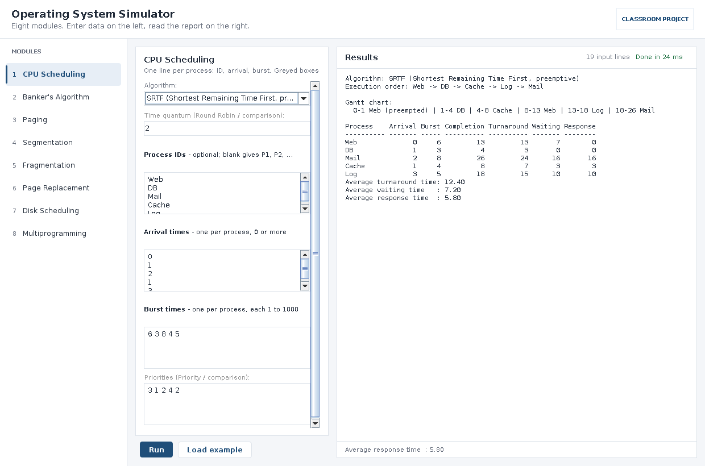

# Opening the project in Eclipse

Everything you need fits on this page. Pick the part that matches what you
are doing now:

| Your situation | Go to |
|----------------|-------|
| This is the first time you put the project in Eclipse | **Part 1** |
| It is already in Eclipse and you only want the newer files | **Part 2** |
| Eclipse shows red crosses, or Java complains about the class version | **Part 3** |
| It is imported and you want to run or present it | **Part 4** |

What the project contains:

| Item | Count | Where |
|------|-------|-------|
| Java source files | 24 (11 console + 13 GUI) | `src/minios/` |
| Sample tests | 36 inputs + 36 expected outputs | `samples/`, `samples/expected/` |
| Ready-made program | 1 | `MiniOS-Simulator.jar` |
| Extra libraries | none | only a JDK is needed |

---

## Part 1: First time in Eclipse

You need two things: the project folder on your disk, and a JDK (Java
17 or newer is the safe choice; 8 and 11 also work).

### 1.1 Get the folder on your disk

Easiest is the ZIP:

1. Open <https://github.com/jroldan9723-gif/Mini_OS-Project>
2. Green **Code** button, then **Download ZIP**.
3. Right-click the download, **Extract All**.
4. Put it somewhere without spaces in the path, for example
   `C:\Users\you\Documents\Mini_OS-Project`.

If you have git, this does the same thing:

```
git clone https://github.com/jroldan9723-gif/Mini_OS-Project.git
```

### 1.2 Find the right folder

Open the extracted folder. It must directly contain these:

```
.project
.classpath
src
samples
MiniOS-Simulator.jar
```

A ZIP download usually wraps everything in an extra folder
(`Mini_OS-Project-main`). If the folder you opened contains only one
folder, go one level deeper. **This is the step people skip**, and it is
why Eclipse answers *"No projects are found to import"*.

### 1.3 Import it

1. **File > Import...**
2. **General > Existing Projects into Workspace**, then **Next**.
3. **Select root directory > Browse**, pick the folder from 1.2.
4. `Mini_OS-Project` appears in the list with a tick. Press **Finish**.

You should now see `src` in Package Explorer, with the packages `minios`
and `minios.gui` inside it.

### 1.4 Set the Java version

Do this only if you see a red cross, or if you plan to hand the project
to someone else. If it already compiles, skip to Part 4.

1. **Window > Preferences > Java > Installed JREs**. Make sure exactly one
   JDK is ticked (Add... > Standard VM > Directory, and pick the JDK
   folder itself, the one that contains `bin` and `lib`).
2. Right-click the project > **Properties > Java Build Path >
   Libraries**. Select **JRE System Library** > **Edit...** >
   **Alternate JRE** > your JDK > **Finish**.
3. Still in Properties, open **Java Compiler** and set **Compiler
   compliance level** to the same number as that JDK (17 for a JDK 17).
4. **Apply and Close**, then **Project > Clean...**, tick the project,
   **Clean**.

The Problems view should end up empty.

### 1.5 Check it works

Open `src/minios/gui/GuiMain.java`, right-click, **Run As > Java
Application**. The window should look like this (tab 1, after **Load
example** then **Run**):



If you got this far, everything is set up.

---

## Part 2: Just updating an existing copy

Do **not** delete the project and import it again. Re-importing throws
away the Java settings from 1.4, and you would have to redo them.

1. Put the new files into the **same folder** on disk:
   * with git: `git pull` inside that folder;
   * with a ZIP: extract it over the folder and choose **Replace files**.
2. In Eclipse, click the project and press **F5** (that is Refresh). The
   new files, including `.settings/`, appear.
3. **Project > Clean...**, tick the project, **Clean**.

Done. The old `bin/` is rebuilt from the new sources.

You only need Part 1 again if you extracted the new ZIP into a
*different* folder, so that two folders called `Mini_OS-Project` now
exist and Eclipse refuses the duplicate name.

---

## Part 3: When something is wrong

| What you see | Why | Fix |
|--------------|-----|-----|
| *No projects are found to import* | wrong folder picked | go one level deeper, pick the folder with `.project` inside (1.2) |
| Project greyed out, *already exists in workspace* | two copies with the same name | delete the copy you do not want (tick *delete contents on disk*), then import the other one |
| Red crosses right after import | the JRE library is not set | 1.4, then Clean |
| *UnsupportedClassVersionError ... class file version 65.0* | compiled by a newer Java than the one running it | see the table below |
| *Selection does not contain a main type* | stale `bin/` folder | **Project > Clean...**, then run again |
| Console does not react to typing | the Console view is not focused | click inside the Console view first, then type |
| *Run this from the project folder* | the test runner cannot find `samples/` | 4.3 below |
| A test says `failed` | an algorithm or a message really changed | compare with `samples/expected/`, and regenerate that file only if the change was intended |

### The class version error, explained once

Every compiled file carries a version number. A Java runtime refuses to
load a file that was compiled for a newer Java than itself. The number in
the error message tells you which Java built it:

| Java | 8 | 11 | 17 | 21 | 25 |
|------|---|----|----|----|----|
| class file version | 52 | 55 | 61 | 65 | 69 |

So *"class file version 65.0, this runtime recognises up to 61.0"* means:
built with Java 21, being run by Java 17. Fix it by pointing the project
at the **older** Java (1.4, choosing that JDK), then Clean. The project
uses nothing newer than Java 8, so any of these versions is fine as long
as the compiler and the runtime agree.

One extra case: if the compliance level box will not accept your number
at all, Eclipse itself is running on an older Java. Either pick the lower
number, or start Eclipse on the newer JDK by putting these two lines in
`eclipse.ini`, above `-vmargs`:

```
-vm
C:\Program Files\Eclipse Adoptium\jdk-17\bin\javaw.exe
```

---

## Part 4: Running things

There are four programs, and it helps to know which is which:

| Class | What it is |
|-------|------------|
| `minios.gui.GuiMain` | the GUI (the one you demonstrate) |
| `minios.Main` | the console menu, same engine |
| `minios.SampleTestRunner` | runs all 36 samples and reports pass or fail |
| `minios.gui.GuiInputSelfTest` | checks the input of all 8 tabs, no window |

### 4.1 The GUI

Right-click `src/minios/gui/GuiMain.java` > **Run As > Java Application**.
On any tab press **Load example**, then **Run**.

The first launch may ask which main class to use; pick `GuiMain`.

### 4.2 The console version

Right-click `src/minios/Main.java` > **Run As > Java Application**, click
inside the Console view, type `1`, press Enter.

To replay a sample file instead of typing:

1. **Run > Run Configurations... > Java Application > Main**
2. **Common** tab > **Standard Input and Output** > tick **Input File**
3. pick e.g. `samples/cpu_srtf.txt`, **Apply**, **Run**

Untick **Input File** afterwards, or every run will replay that same file.

No Input File box in your Eclipse? Use a terminal in the project folder:

```
java -cp bin minios.Main < samples/cpu_srtf.txt
```

### 4.3 The regression test

Right-click `src/minios/SampleTestRunner.java` > **Run As > Java
Application**. It ends with:

```
Result: 36 passed, 0 failed, 36 total.
```

It needs the project folder as working directory, which Eclipse uses by
default. If you see *"Run this from the project folder"*, go to **Run
Configurations > SampleTestRunner > Arguments** and set **Working
directory > Other > Workspace > Mini_OS-Project**.

### 4.4 The GUI input test

Right-click `src/minios/gui/GuiInputSelfTest.java` > **Run As > Java
Application**. Expect 11 `PASS` lines and `ALL GUI CHECKS PASSED`. No
window should open; if one does, something is wrong.

### 4.5 The JAR

In a terminal, inside the project folder:

```
java -jar MiniOS-Simulator.jar
```

The JAR is a copy of the code from when it was exported. Editing a
`.java` file does **not** update it. To make a new one:

1. **Project > Clean...**
2. **File > Export... > Java > Runnable JAR file > Next**
3. Launch configuration `GuiMain - Mini_OS-Project`
4. Export destination: `MiniOS-Simulator.jar` in the project folder
5. **Finish**, accept the overwrite

---

## Before you present

1. Problems view empty (no red crosses).
2. `GuiMain` opens, and all eight tabs answer Load example then Run.
3. `SampleTestRunner`: `36 passed, 0 failed`.
4. `GuiInputSelfTest`: `ALL GUI CHECKS PASSED`.
5. `java -jar MiniOS-Simulator.jar` opens the same GUI.
6. `samples/` and `samples/expected/` are both still there (the test
   runner needs them; the GUI does not).
