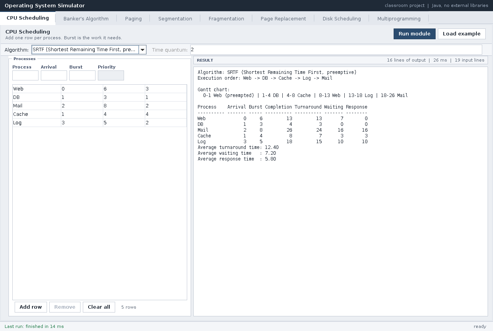

# Mini OS Simulator

An interactive Operating System simulator written in Java. It comes as a
GUI application (the default) and as a text menu version, both running the
same engine. Covered topics: CPU scheduling, Banker's algorithm, paging,
segmentation, fragmentation, page replacement, disk scheduling and
multiprogramming.

Note: this is an educational demonstration of OS concepts. It is NOT a
real operating system and does not manage any real hardware.

```
Programming language : Java (standard library only, no external dependencies)
Interface            : GUI (Swing) + console menu
Minimum JDK          : 8 or newer
Entry points         : minios.gui.GuiMain (GUI), minios.Main (console)
```

## Contents

1. [Running the program](#running-the-program)
2. [How the GUI is organized](#how-the-gui-is-organized)
3. [Modules and algorithms](#modules-and-algorithms)
4. [Input checking](#input-checking)
5. [Testing](#testing)
6. [Project structure](#project-structure)
7. [Assumptions and limits](#assumptions-and-limits)
8. [Preparing the 10-minute demonstration](#preparing-the-10-minute-demonstration)
9. [Submission checklist map](#submission-checklist-map)

---

## Running the program

### GUI (default)

From a terminal, in the project folder:

```
java -jar MiniOS-Simulator.jar
```

In Eclipse: import the project (File > Import > General > Existing
Projects into Workspace), open `src/minios/gui/GuiMain.java` and choose
Run As > Java Application. Already have it imported and just need the
newer code? `ECLIPSE-SETUP.md` has the six steps for that (find the
folder, download, paste and replace, F5, Clean, run), its step 7 lists
the run steps for all four programs, and it ends with the one-time
import if you do not have the project in Eclipse yet.

### Console menu (same engine, text mode)

```
java -cp bin minios.Main
```

In Eclipse: run `src/minios/Main.java` the same way. The console version
is useful for typing full test sessions and for redirecting input files
from `samples/`.

### Building from source (without Eclipse)

```
javac -d bin src/minios/*.java src/minios/gui/*.java
java -cp bin minios.gui.GuiMain
```

On Windows the same two commands work in the Command Prompt.

### Making your own runnable JAR in Eclipse

1. File > Export...
2. Java > Runnable JAR file > Next
3. Launch configuration: `GuiMain - Mini_OS-Project` (Eclipse names it
   after the class and the project)
4. Export destination: any file name ending in `.jar`

The repository already contains a ready-made `MiniOS-Simulator.jar`, so
step-by-step exporting is only needed if you changed the code.

---

## How the GUI is organized

One window, a row of tabs across the top, the input groups on the left and
the report on the right:

```
+----------------------------------------------------------------------+
| Operating System Simulator                    classroom project  ...  |
+----------------------------------------------------------------------+
| CPU Scheduling | Banker's Algorithm | Paging | Segmentation | ...    |
+----------------------------------------------------------------------+
| CPU Scheduling                                                       |
| Add one row per process. Burst is the work it needs.                 |
|                                        [ Run module ] [ Load example ]|
+----------------------------------------------------------------------+
| Algorithm: [SRTF ... v]   Time quantum: [ 2 ]                        |
+-----------------------------+----------------------------------------+
| +- Processes -------------+ | RESULT       16 lines | 24 ms | 19 in |
| | Process  Arrival  Burst  | | Algorithm: SRTF (preemptive)          |
| | [      ] [      ] [    ] | | Execution order: Web -> DB -> ...     |
| |         [ Add row ]      | | Gantt chart:                          |
| |                          | | Process Arrival Burst Completion ...  |
| | Web      0        6      | | Average waiting time: 7.20            |
| | DB       1        3      | | Average response time: 5.80           |
| | Mail     2        8      | |                                       |
| |     [Add][Remove][Clear] | |                                       |
| +--------------------------+ |                                       |
+-----------------------------+----------------------------------------+
| Last run: finished in 24 ms                                  ready   |
+----------------------------------------------------------------------+
```

The window opens at 1280 x 860 and shrinks down to 1020 x 660. One line
settings such as the algorithm and the time quantum sit in a strip under
the tab, so the boxes on the left only hold the data lists.

Every screen has the same two buttons:

* **Run** - checks the form, runs the module, prints the full report into
  the result pane.
* **Load example** - fills the form with a small working dataset, handy
  for a quick test or a live demonstration.

`screenshots/` holds one picture of every screen, taken after pressing
Load example and then Run:

`1-cpu-scheduling.png`, `2-banker.png`, `3-paging.png`,
`4-segmentation.png`, `5-fragmentation.png`, `6-page-replacement.png`,
`7-disk-scheduling.png`, `8-multiprogramming.png`. The two
`all-screens-*.png` files show four screens each on one sheet.



Data is entered one row at a time, not typed into a text box. Every
module has the same table editor: fill the boxes above the table, press
**Add row**, and the row appears below while the boxes empty themselves
ready for the next one.

```
 Job      Memory   Burst   Arrival
 [....]   [....]   [....]   [....]     <- type here
                        [ Add row ]    <- then press this

 J1      40       7       0
 J2      30       4       2
```

* **Click a row** to load it back into the boxes. The button changes to
  **Save changes**, so a typo can be fixed and saved over the old row.
  **Cancel** leaves the row alone.
* **Remove** deletes the selected row.
* **Clear all** empties the table.
* A row that is not valid yet, or that repeats a name already in the
  table, is refused with a short message and is not added.

The number of rows is unlimited. Only the values are checked (a burst
must be positive, a request must lie on the disk, and so on). Everything
is checked again when **Run** is pressed, and a dialog explains exactly
what to fix.

Rows that the chosen option does not use are greyed out, not deleted:
the quantum box on the CPU screen, the priorities box unless Priority or the
comparison is picked, the request boxes on the Banker screen unless a
resource request is picked, the direction on the disk screen for FCFS and
SSTF, and whichever half of the fragmentation screen the chosen demo does
not read. Filling a greyed-out box does nothing, because it is never
sent to the module.

The output pane shows only the results: no menus and no input prompts.
The GUI collects and validates the input, then asks the same calculation
code the console uses to do the work with prompts switched off
(`InputHelper.setQuiet`), so both versions compute identical numbers while
the GUI stays clean for a demonstration.

How the source is commented: every class starts with a short note saying
what it does, and the parts that are easy to get wrong (the quiet
switch, the Round Robin quantum, the Banker safety loop, the page
replacement rules) are explained where they happen. The comments are
short and stay out of the way of the code.

---

## Modules and algorithms

| # | Module | What it simulates | Algorithms |
|---|--------|-------------------|------------|
| 1 | CPU scheduling | execution order, waiting and turnaround times | FCFS, SJF, Round Robin, SRTF, Priority, 4-way comparison |
| 2 | Banker's algorithm | deadlock avoidance, safe states | Need matrix, safety algorithm, resource request algorithm |
| 3 | Paging | page-to-frame mapping, address translation | direct mapping, page faults |
| 4 | Segmentation | base/limit translation, address validation | overlap and bounds checks |
| 5 | Fragmentation | internal and external fragmentation | First-Fit, Best-Fit, Worst-Fit, comparison |
| 6 | Page replacement | replacing pages when RAM is full | FIFO, LRU, Optimal, LFU with rates and comparison |
| 7 | Disk scheduling | service order of disk requests | FCFS, SSTF, SCAN, C-SCAN, LOOK, C-LOOK, 6-way comparison |
| 8 | Multiprogramming | jobs sharing CPU, memory and one I/O device | Round Robin, first-fit loading, I/O queue |

### 1. CPU scheduling

Console menu: FCFS, SJF, Round Robin, the four-way comparison, SRTF and
Priority. Every algorithm asks for all four pieces of data the rubric
lists: a process name (or Enter for the default P1, P2, ...), an arrival
time, a CPU burst time, and a priority where the algorithm uses one.

How the algorithms work:

* **FCFS** - the arrived process that came first runs first. If a process
  has not arrived yet, the CPU sits idle in the Gantt chart until it does.
* **SJF (non-preemptive)** - whenever the CPU becomes free, the arrived
  process with the shortest burst runs next. Ties: earlier arrival, then
  input order.
* **Round Robin** - processes join the ready queue as they arrive and
  each gets one slice of the quantum; an unfinished process goes to the
  back, behind anyone who arrived during its slice. The execution list
  shows one entry per slice, so a name can appear several times.
* **SRTF (preemptive)** - at every tick the arrived process with the
  smallest remaining burst runs; ties go to the earlier arrival, then the
  input order. If nobody has arrived, the Gantt chart shows `idle`.
* **Priority (non-preemptive)** - the arrived process with the smallest
  priority number runs next (smaller number = higher priority). Ties:
  earlier arrival, then input order.

Every run reports the execution order, a Gantt chart with preemptions and
idle gaps, and a table of arrival, burst, completion, turnaround
(`completion - arrival`), waiting (`turnaround - burst`) and response
(`first start - arrival`) with the three averages.

The comparison option runs FCFS, SJF, Round Robin and Priority on the
same processes and prints waiting/turnaround per process and per
algorithm plus the winner for each average, so it is easy to say which
one wins on that data.

Sample session (input `samples/cpu_fcfs.txt`, full output in
`samples/expected/cpu_fcfs.txt`): four named processes arrive at 0, 1, 2
and 3, so FCFS serves them in arrival order:

```
Gantt chart:
  0-8 Shell | 8-12 Editor | 12-21 Compile | 21-26 Render

Process    Arrival Burst Completion Turnaround Waiting Response
---------- ------- ----- ---------- ---------- ------- --------
Shell            0     8          8          8       0        0
Editor           1     4         12         11       7        7
Compile          2     9         21         19      10       10
Render           3     5         26         23      18       18
Average turnaround time: 15.25
Average waiting time   : 8.75
Average response time  : 8.75
```

### 2. Banker's algorithm

Two modes:

1. **Enter data and check for a safe state** - you give the number of
   processes, the number of resource types, the Allocation matrix, the
   Max matrix and the Available vector. The program computes
   `Need = Max - Allocation` and runs the safety algorithm: repeatedly
   find a process whose whole Need fits in Work, let it run to
   completion and return its Allocation to Work. If every process can
   finish this way the state is SAFE and one safe sequence is printed,
   otherwise the state is UNSAFE and the stuck processes are listed.
2. **Resource request** - for a chosen process the three validity checks
   run first (negative values, request above Need, request above
   Available), then the request is tentatively granted and the safety
   algorithm runs again. Grant only if the result is still safe;
   otherwise Allocation and Available are restored to the old values.
   The data you entered last stays loaded, so several requests can be
   tested in one session.

Known-answer examples: `samples/banker_safe.txt` produces
`Safe sequence: P2 -> P4 -> P1 -> P3 -> P5`, and
`samples/banker_unsafe.txt` produces `RESULT: UNSAFE STATE`.

### 3. Paging

Enter the page size, the number of pages and the frame for each page
(`-1` means the page is on disk). Every logical address you type is split

```
page   = address / pageSize
offset = address %  pageSize
physical = frame * pageSize + offset
```

Addresses outside the logical space, and pages that are not in memory
(page faults), are reported instead of translated. Page and frame numbers
are stored and computed with long arithmetic, so a page table such as
200000 pages x 1048576 bytes cannot overflow.

### 4. Segmentation

Enter RAM size and one `base limit` pair per segment. Each segment is
checked while you type it: base >= 0, limit > 0, the last byte
(`base + limit - 1`) inside RAM, and no overlap with an earlier segment.
Anything invalid is re-entered before the table is accepted.

Translating `segment:offset` checks that the segment exists, the offset
is not negative and not past the limit, and the physical address is
inside RAM. Failures print an INVALID ADDRESS or SEGMENTATION FAULT
line; a good address prints `base + offset = physical address`.

### 5. Fragmentation

* **Internal (fixed partitions)** - processes are placed into fixed
  partitions with First-Fit, Best-Fit or Worst-Fit. The waste inside a
  partition (`partition size - process size`) is internal fragmentation,
  summed at the end. Processes that fit nowhere have to wait.
* **External (variable memory)** - jobs are allocated in order, some are
  freed again, and then a new request is tested against the holes. The
  verdict is one of: fits, external fragmentation (enough memory in
  total but no single hole), or not enough memory.

The comparison option runs all three strategies on exactly the same data
and prints the memory maps side by side. In `samples/fragment_compare.txt`
the totals are First-Fit 80 KB, Best-Fit 80 KB, Worst-Fit 180 KB, and the
Worst-Fit summary shows why: it gives the biggest partition to the first
process, so the last one cannot fit.

### 6. Page replacement

One reference string and a frame count are entered, then all four
algorithms run on that same data:

* **FIFO** - replace the page that has been in memory the longest.
* **LRU** - replace the page that was least recently used.
* **Optimal** - replace the page needed farthest in the future (the
  benchmark that real algorithms try to approach).
* **LFU** - replace the page with the lowest use frequency so far; ties
  are broken with LRU. Each frame keeps a frequency counter that starts
  at 1 when the frame is loaded.

Each algorithm prints one row per reference (frames, and frequencies for
LFU, plus HIT or FAULT), then faults, hits, fault rate and hit rate. The
final comparison table names the algorithm with the fewest faults, for
example in `samples/page_replacement.txt`:

```
  Algorithm   Faults   Hits   Fault rate   Hit rate
  ---------   ------   ----   ----------   ---------
  FIFO          10      3       76.92%      23.08%
  LRU            9      4       69.23%      30.77%
  Optimal        7      6       53.85%      46.15%
  LFU            8      5       61.54%      38.46%
  Fewest page faults: Optimal (7).
```

### 7. Disk scheduling

Six algorithms: FCFS (queue order), SSTF (closest request first), SCAN
and C-SCAN (sweep to the disk boundary before turning or wrapping), LOOK
and C-LOOK (turn at the last request instead of the boundary). SCAN,
C-SCAN, LOOK and C-LOOK start in the direction you choose.

Every result prints the service order and the total head movement. The
step annotations say what happened: `(at head)` costs 0, `(end of disk)`
is a boundary trip, `(wrap)` and `(jump)` are the long jumps of the
circular algorithms, and those jumps are counted in the total (some books
exclude them; the program states it in the summary). The comparison
option runs all six on the same queue and prints the movement of each
one. `samples/disk.txt` uses the classic textbook queue
`98 183 37 122 14 124 65 67` from head 53, where FCFS costs 640
cylinders while SSTF costs 236.

### 8. Multiprogramming

Enter main memory size, one line per job (`name mem burst arrival`) and
the Round Robin quantum. The rules of the simulation:

* a job exists for the OS only once its arrival time is reached;
* queued jobs are loaded first-fit into free memory;
* the CPU works Round Robin with the given quantum;
* each job does one I/O of 3 ticks at the halfway point of its burst,
  one job at a time on the single device (others wait in the I/O queue);
* when a job finishes, its memory is freed immediately.

Every tick prints one table row: CPU, ready queue, waiting jobs, I/O
device, job queue, jobs that have not arrived, and the memory map with
free ranges whenever memory changed. If a queued job would fit in total
free memory but not in any single hole, the row is marked as external
fragmentation. The final report lists per job arrival, memory, burst,
load time, finish time, turnaround (`finished - arrival`) and waiting
time, followed by averages, CPU utilization and the completion count.
`samples/multiprogramming.txt` reports `CPU utilization: 95.00%`
(19 busy ticks out of 20).

---

## Input checking

The program never crashes on bad input; it explains the problem and asks
again (console) or shows a dialog and runs nothing (GUI).

| What you enter | Rule | On violation |
|----------------|------|--------------|
| Menu choices | a listed number | re-prompted with the valid range |
| Counts (processes, pages, segments, requests, jobs, ...) | at least 1 (0 allowed where the program says so) | re-prompted; no upper limit is imposed |
| Burst times, partition sizes, page sizes | positive, program-specific maximum | re-prompted / dialog |
| Arrival times | 0 or more | re-prompted / dialog |
| Process names | optional, unique, 10 characters or fewer | re-prompted / dialog |
| Matrices (banker) | same shape row by row, Max >= Allocation, no negatives | whole data set entered again / dialog |
| Disk requests | between 0 and max cylinder | whole problem entered again / dialog |
| Segments | non-overlapping, inside RAM | that segment entered again / dialog |
| Page references | 0 or more | run restarted / dialog |
| Job names | non-empty and unique | re-prompted / dialog |
| Blank fields | not accepted | "nothing was typed" message / dialog |

The console version shows the message directly in the transcript (see
`samples/cpu_invalid_input.txt` for a run full of deliberate mistakes),
the GUI version shows it as a warning dialog.

---

## Testing

### Sample regression test (small, boundary and large inputs for every module)

```
java -cp bin minios.SampleTestRunner
```

The runner executes every file in `samples/` through the console app in
a fresh JVM and compares the output with `samples/expected/` (line
endings are normalized, so it works on Windows and on Linux). Current
result: **36 of 36 passed**.

| Module | Small inputs | Boundary inputs | Substantially larger input |
|--------|--------------|-----------------|-----------------------------|
| CPU scheduling | cpu_fcfs, cpu_sjf, cpu_rr, cpu_srtf, cpu_priority, cpu_compare, cpu_invalid_input | boundary_cpu_single (one process, burst 1), boundary_cpu_zero_burst (burst 0 rejected, then accepted) | cpu_large: 30-process four-way comparison plus 30-process SRTF, all with arrival times |
| Banker's algorithm | banker_safe, banker_unsafe, banker_request (granted and denied cases) | boundary_banker_tiny: one process, one resource type | banker_large: 15 processes x 5 resource types |
| Paging | paging | boundary_paging_last_page: last valid address 2047 and the first invalid 2048 | paging_large: 60-page table, 25 addresses |
| Segmentation | segmentation, segmentation_overlap | boundary_seg_last_byte: segment ending on the last RAM byte, then offset 1024 rejected | segmentation_large: 18 segments, 14 addresses |
| Fragmentation | fragment_internal, fragment_external, fragment_compare | boundary_fragment_exact: process exactly filling its partition (0 KB waste) | fragment_large: 14 jobs, 5 frees, three strategies compared |
| Page replacement | page_replacement | boundary_page_one_frame: a single frame, so every miss evicts the only page | page_replacement_large: 220 references, 5 frames, four algorithms |
| Disk scheduling | disk | boundary_disk_ends: request under the head (0 movement) and the far end of the disk | disk_large: 70 requests, all six algorithms |
| Multiprogramming | multiprogramming | boundary_multi_single: a single job, minimum memory and quantum | multiprogramming_large: 12 jobs with staggered arrivals |

Exceptional cases are tested as well, not only the happy path:
`cpu_invalid_input` (letters where numbers belong, then a valid answer),
`boundary_cpu_zero_burst` (a burst of 0 is rejected and re-asked),
`banker_unsafe` (no safe sequence exists) and `banker_request` (a request
that is granted and one that is denied), `segmentation_overlap` (two
segments that overlap), and the addresses in `paging` that fall outside
the address space.

### GUI input test

```
java -cp bin minios.gui.GuiInputSelfTest
```

Loads the example of every screen, builds the input script, runs the real
module and checks the expected section of the output, including all
three Banker script shapes (first run, data unchanged, data edited).
Current result: **ALL GUI CHECKS PASSED** (11 checks).

### Table button test

```
java -cp bin minios.gui.GuiTableSelfTest
```

Types into the entry boxes and presses Add row, Save changes, Remove and
Clear all the way a user would, then checks what the table holds. It also
checks that a repeated process name is refused. Current result:
**ALL EDIT CHECKS PASSED** (15 checks).

### Result verification

Outputs are deterministic (every run was repeated and compared), and
several cases were checked by hand against known results:

* the CPU samples were worked out on paper first and the program matches:
  FCFS with staggered arrivals gives waiting 0, 7, 10, 18 (average 8.75),
  SJF serves P1, P3, P2, P4 for an average wait of 4.00, Priority serves
  P1, P2, P3 for 2.67, and the Round Robin trace (quantum 2) was traced
  slice by slice down to the last completion;
* four-way comparison with arrivals 0/1/2 and priorities 2/1/3 gives
  FCFS 3.33 / SJF 3.33 / RR 5.67 / Priority 3.33 average waiting, with
  the RR completion times re-derived by hand;
* the classic banker dataset in `banker_safe.txt` has the known safe
  sequence `P2 -> P4 -> P1 -> P3 -> P5`, and `banker_unsafe.txt` is the
  matching unsafe case;
* `disk.txt` is the textbook queue where FCFS = 640 and SSTF = 236
  cylinders;
* the fragmentation comparison totals (80 / 80 / 180 KB) were derived by
  hand from the partition and process lists;
* the multiprogramming sample was traced tick by tick: waiting times
  2, 5, 10 and 9, and CPU utilization 19 busy ticks out of 20 = 95%.

---

## Project structure

```
Mini_OS-Project/
|-- README.md                      this file
|-- ECLIPSE-SETUP.md               how to update the code inside Eclipse
|-- MiniOS-Simulator.jar           runnable GUI application
|-- AGENTS.md                      notes for automated contributors
|-- .project, .classpath           Eclipse project files
|-- src/
|   |-- minios/
|   |   |-- Main.java                    console menu, entry point
|   |   |-- InputHelper.java             input reading and validation
|   |   |-- SampleTestRunner.java        regression test runner
|   |   |-- CPUScheduler.java            FCFS, SJF, RR, SRTF, Priority
|   |   |-- BankersAlgorithm.java        safety check + resource requests
|   |   |-- PagingSimulator.java         page table and translation
|   |   |-- SegmentationSimulator.java   segments and address checks
|   |   |-- FragmentationDemo.java       internal/external + strategies
|   |   |-- PageReplacementSimulator.java FIFO, LRU, Optimal, LFU
|   |   |-- DiskScheduler.java           six disk algorithms
|   |   |-- MultiprogrammingSimulator.java tick-by-tick simulation
|   |   `-- gui/
|   |       |-- GuiMain.java             main window (entry point of the JAR)
|   |       |-- ModulePanel.java         shared screen layout and Run handling
|   |       |-- Theme.java               colours and fonts for the window
|   |       |-- Ui.java                  field helpers and validation
|   |       |-- Runner.java              adapter: GUI input -> console module
|   |       |-- CpuPanel.java            tab 1
|   |       |-- BankerPanel.java         tab 2
|   |       |-- PagingPanel.java         tab 3
|   |       |-- SegmentationPanel.java   tab 4
|   |       |-- FragmentationPanel.java  tab 5
|   |       |-- PageReplacePanel.java    tab 6
|   |       |-- DiskPanel.java           tab 7
|   |       |-- MultiPanel.java          tab 8
|   |       |-- GuiTableSelfTest.java    add / edit / remove checks
|   |       |-- RecordEditor.java        table with Add and Edit buttons
|   |       |-- Group.java               titled frame around a group of fields
|   |       |-- StripTabs.java           hand drawn tab strip
|   |       `-- GuiInputSelfTest.java    headless GUI checks
|   `-- (bin/ appears after Eclipse or javac builds the project)
`-- samples/
    |-- *.txt                     36 test inputs (small, boundary and large)
    `-- expected/                 36 reference outputs
```

---

## Assumptions and limits

* All CPU scheduling algorithms take an arrival time per process. The
  CPU idles (shown as `idle` in the Gantt chart) until the next arrival
  when nothing is ready to run.
* Priority scheduling: smaller number = higher priority, no preemption.
  Ties are broken by earlier arrival, then input order.
* Round Robin quantum is 1..100 ticks, entered per run. Processes that
  arrive during a slice join the ready queue before the preempted
  process goes back in.
* Process names are optional (defaults P1, P2, ...), must be unique and
  at most 10 characters, which keeps the tables aligned.
* C-SCAN and C-LOOK count their long jump in the total head movement;
  the summary repeats this, because some books exclude it.
* The multiprogramming simulation uses first-fit loading, one shared I/O
  device, one I/O of 3 ticks per job at the halfway point of its burst,
  and a 10000-tick safety limit that a normal run never reaches.
  Waiting time counts every tick a job spends not running and not on the
  device; turnaround is `finished at - arrival time`.
* Banker's algorithm keeps the last valid data set, so follow-up
  requests do not need to retype the matrices (a data change triggers a
  reload automatically in the GUI).
* Counts of items (how many processes, pages, requests, jobs, ...) have
  no program-imposed maximum; the practical limit is memory, as stated
  in the rubric. Individual values still have sensible ranges (for
  example burst times 1..1000) that are validated on entry.
* The GUI shows the module output as plain monospaced text, which keeps
  tables aligned exactly like the console version.

---

## Preparing the 10-minute demonstration

Suggested schedule (from the rubric) and where to show things:

| Time | What to do |
|------|-----------|
| 1 min | Introduction: title, Java, GUI, purpose (use the first paragraph of this file; state clearly it is not a real OS). |
| 2 min | Structure: open the GUI, click through the eight tabs, show the form, the Run button and the output pane; mention `minios.gui.GuiMain` and that the console menu is the same engine. |
| 4 min | Live demonstration: on each tab press Load example then Run. For the required coverage show all eight tabs; spend extra time on CPU scheduling (Gantt chart), Banker's algorithm (safe sequence and a denied request) and one more module of your choice. Have `SampleTestRunner` output ready as backup evidence. |
| 2 min | Algorithm explanation: pick one algorithm (for example SRTF or the safety algorithm) and walk through its lines in the output; compare two algorithms using a comparison option (CPU four-way, fragmentation three-way, disk six-way). Mention one challenge you hit and how it was solved (for example C-LOOK's jump annotation or the overlapping-segment re-entry). |
| 1 min | Questions and conclusion. |

Likely technical questions and short answers:

* **How does SRTF decide each tick?** It looks at every arrived,
  unfinished process and picks the smallest remaining burst; ties go to
  the earlier arrival, then the input order. A Gantt segment ends when
  someone else becomes shorter.
* **What happens when no process has arrived yet?** The CPU is idle for
  that stretch; the Gantt chart shows it as `idle` and it no longer adds
  to anyone's waiting time.
* **What is a safe sequence?** An order in which every process can
  obtain its maximum need and finish, assuming they run one after
  another and return their resources. If none exists, the state is
  unsafe.
* **Why does LOOK move less than SCAN?** It turns around at the last
  request instead of travelling to the disk boundary first.
* **What is external fragmentation?** Enough free memory in total, but
  split into holes, so a large request still fails. The multiprogramming
  memory map prints a warning line when this happens.
* **Why does the GUI output look like the console?** The GUI builds the
  same input lines and shows what the console module prints, which keeps
  one implementation of every algorithm and identical results.

---

## Submission checklist map

| Rubric checklist item | Where it is |
|-----------------------|-------------|
| Source code (Java) | `src/minios/` (11 console classes + 13 GUI classes) |
| Runnable application | `MiniOS-Simulator.jar` (`java -jar MiniOS-Simulator.jar`) |
| Dependencies and setup instructions | none beyond a JDK; see "Running the program" |
| Documentation of modules and algorithms | this README, section "Modules and algorithms" |
| Sample inputs and outputs | `samples/` and `samples/expected/` (36 pairs) |
| Test evidence, small and large inputs | testing table above (small, boundary/exceptional and large for all 8 modules); `SampleTestRunner` output |
| GUI with flexible, user-defined input | list fields with no fixed item limit on every tab |
| Input validation without crashes | section "Input checking"; `cpu_invalid_input.txt`; GUI dialogs |
